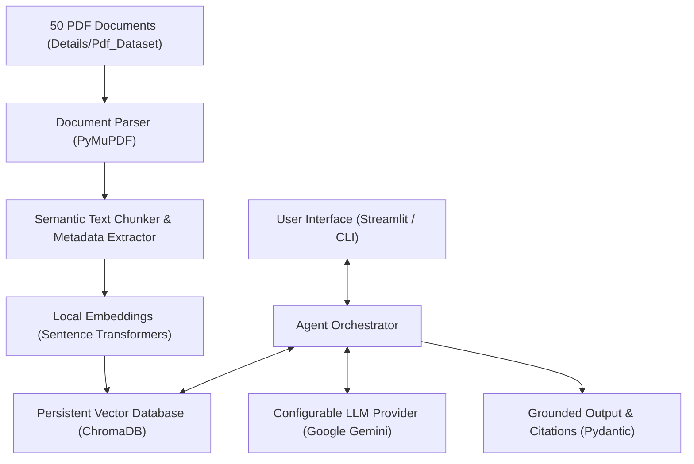

# PDF Document Summarization & Insight Agent (UC05)

An intelligent, multi-domain AI assistant designed to ingest, analyze, categorize, and synthesize insights across 50 heterogeneous PDF documents spanning Technology, Science, Finance, History, and Earth Sciences.

---

## 🎯 Project Overview & Objective

Organizations frequently work with large volumes of complex documents (research papers, financial filings, technical reports, and environmental analyses). Reading each document manually to identify core purposes, key findings, statistics, dates, and conclusions is costly and time-consuming.

The **PDF Document Summarization & Insight Agent** automates this by providing:
- **Full Corpus Understanding:** Ingestion and indexing of all 50 provided PDF documents.
- **2-Line High-Density Insights:** Rapid executive summaries capturing core essence without fluff.
- **Structured Multi-Section Summaries:** Granular breakdowns of findings, metrics, dates, and recommendations.
- **Automated Categorization:** Domain identification across AI/Tech, Physics, Biology, Finance/Economics, History, and Earth Sciences.
- **Document-Grounded Q&A:** Accurate answers supported by verbatim citations and page references.
- **Multi-Turn Conversational Memory:** Seamless support for contextual follow-up inquiries.
- **Multi-Document Comparison:** Cross-document comparative synthesis (e.g. comparing quantum computing with classical high-frequency trading).
- **Hallucination Prevention:** Explicit statements when information is absent or insufficient in the dataset.

---

## 🏗️ Architecture & Technology Stack



### Stack Components:
- **Language / Runtime:** Python 3.11+ (tested on Python 3.12.2)
- **User Interface:** [Streamlit](https://streamlit.io/)
- **Document Extraction:** [PyMuPDF (fitz)](https://pymupdf.readthedocs.io/)
- **Embeddings:** [Sentence-Transformers](https://sbert.net/) (`all-MiniLM-L6-v2`)
- **Vector Database:** [ChromaDB](https://www.trychroma.com/) (persistent local storage)
- **LLM Provider:** Configurable via Google Gemini (`google-generativeai`)
- **Validation & Schemas:** [Pydantic v2](https://docs.pydantic.dev/)
- **Environment Management:** `python-dotenv`
- **Testing:** `pytest`

---

## 📂 Project Structure

```
AI-Agent/
├── .env.example              # Template environment configuration
├── .gitignore                 # Comprehensive git exclusion rules
├── requirements.txt           # Project dependencies
├── README.md                  # Project documentation & architecture
├── app.py                     # Application entry point (Streamlit UI & CLI)
├── Details/                   # Source documentation and dataset
│   ├── Use_Case_Details.docx
│   └── Pdf_Dataset-20261010T065421Z-1-001/Pdf_Dataset/ (50 PDFs)
├── src/
│   ├── __init__.py
│   ├── config.py              # Configuration loading, validation, and safe defaults
│   ├── models/                # Pydantic schemas (Metadata, Insights, Citations, Q&A)
│   │   ├── __init__.py
│   │   └── schemas.py
│   ├── ingestion/             # PDF text extraction and semantic chunking (Phase 02)
│   │   └── __init__.py
│   ├── vectorstore/           # ChromaDB indexer and similarity search (Phase 02)
│   │   └── __init__.py
│   ├── agent/                 # Agent orchestration and multi-document reasoning
│   │   └── __init__.py
│   └── utils/
│       ├── __init__.py
│       └── logger.py          # Formatted logging utility
└── tests/
    ├── __init__.py
    ├── test_config.py         # Configuration and credential validation tests
    └── test_app_setup.py      # App import, CLI execution, and schema tests
```

---

## 🚀 Getting Started

### 1. Prerequisites
- Python 3.11+ installed.
- Git.

### 2. Virtual Environment Setup
Create and activate a local virtual environment:

```bash
# Windows (PowerShell)
python -m venv .venv
.\.venv\Scripts\Activate.ps1

# Linux / macOS
python3 -m venv .venv
source .venv/bin/activate
```

### 3. Dependency Installation
Install required dependencies:

```bash
pip install -r requirements.txt
```

### 4. Environment Configuration
Copy the template configuration to create your local `.env`:

```bash
cp .env.example .env
```

Edit `.env` to configure your settings:
```dotenv
LLM_PROVIDER=gemini
GEMINI_API_KEY=your_gemini_api_key_here
GEMINI_MODEL=gemini-1.5-flash
EMBEDDING_MODEL_NAME=all-MiniLM-L6-v2
CHROMA_PERSIST_DIR=./data/chroma_db
PDF_DATASET_DIR=./Details/Pdf_Dataset-20261010T065421Z-1-001/Pdf_Dataset
```

*(Note: An LLM API key is not required to import the project, run tests, or inspect setup readiness).*

### 5. Run Verification & Tests
Execute automated tests using pytest:

```bash
pytest -v
```

### 6. Launch Application
To launch the Streamlit web dashboard:

```bash
streamlit run app.py
```

Or view setup status directly via CLI:

```bash
python app.py
```

---

## 🗺️ Roadmap & Implementation Phases

- **Phase 00: Inspection & Verification** ✅ *(Completed)*
- **Phase 01: Project Foundation & Architecture** 🚀 *(In Progress / Completed)*
  - Modular project structure, dependency definition, configuration loader, domain models, tests.
- **Phase 02: Ingestion & Vector Indexing**
  - PyMuPDF extraction, domain categorizer, semantic chunking, and ChromaDB persistent embedding.
- **Phase 03: Executive Insight & Summarization Engine**
  - 2-line insight generator, structured summary generator, key metrics & findings extractor.
- **Phase 04: Grounded Q&A, Multi-Doc Reasoning & UI Demo**
  - Evidence-backed conversational QA, multi-document comparison, Streamlit interactive interface.
