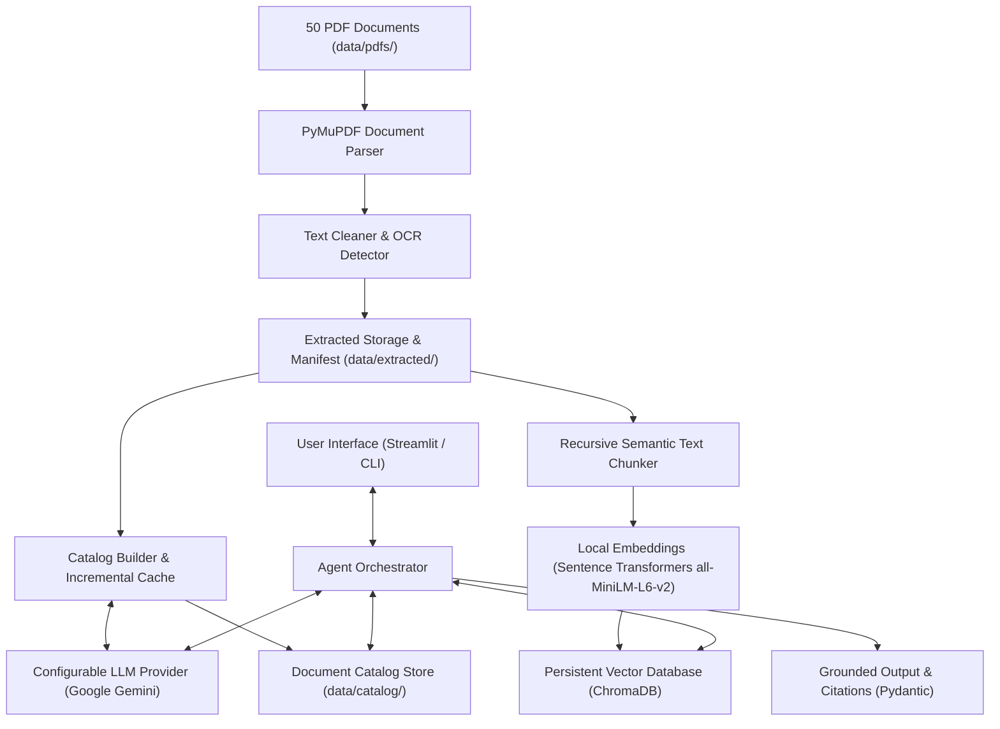

# PDF Document Summarization & Insight Agent (UC05)

An intelligent, multi-domain AI assistant designed to ingest, analyze, categorize, and synthesize insights across 50 heterogeneous PDF documents spanning Technology, Science, Finance, History, and Earth Sciences.

---

## 🎯 Project Overview & Objective

Organizations frequently work with large volumes of complex documents (research papers, financial filings, technical reports, and environmental analyses). Reading each document manually to identify core purposes, key findings, statistics, dates, and conclusions is costly and time-consuming.

The **PDF Document Summarization & Insight Agent** automates this by providing:
- **Full Corpus Understanding:** Ingestion and indexing of all 50 provided PDF documents.
- **2-Line High-Density Insights:** Rapid executive summaries capturing core essence without fluff.
- **Structured Multi-Section Summaries:** Granular breakdowns of findings, metrics, dates, and recommendations.
- **Automated Categorization:** Domain identification across AI/Tech, Physics, Biology, Finance/Economics, History, and Earth Sciences.
- **Semantic Vector Search:** Deep contextual similarity retrieval using Sentence-Transformers & persistent ChromaDB storage.
- **Document-Grounded Q&A:** Accurate answers supported by verbatim citations and page references.
- **Multi-Turn Conversational Memory:** Seamless support for contextual follow-up inquiries.
- **Multi-Document Comparison:** Cross-document comparative synthesis (e.g. comparing quantum computing with classical high-frequency trading).
- **Hallucination Prevention:** Explicit statements when information is absent or insufficient in the dataset.

---

## 🏗️ Architecture & Technology Stack



### Stack Components:
- **Language / Runtime:** Python 3.11+ (tested on Python 3.12.2)
- **User Interface:** [Streamlit](https://streamlit.io/)
- **Document Extraction:** [PyMuPDF](https://pymupdf.readthedocs.io/)
- **Embeddings:** [Sentence-Transformers](https://sbert.net/) (`all-MiniLM-L6-v2`)
- **Vector Database:** [ChromaDB](https://www.trychroma.com/) (persistent local storage in `./data/chroma_db`)
- **LLM Provider:** Configurable via Google Gemini (`google-generativeai`)
- **Validation & Schemas:** [Pydantic v2](https://docs.pydantic.dev/)
- **Environment Management:** `python-dotenv`
- **Testing:** `pytest`

---

## 📂 Project Structure

```
AI-Agent/
├── .env.example              # Template environment configuration
├── .gitignore                 # Comprehensive git exclusion rules
├── requirements.txt           # Project dependencies
├── README.md                  # Project documentation & architecture
├── app.py                     # Application entry point (Streamlit UI & CLI)
├── Details/                   # Source documentation and dataset
│   ├── Use_Case_Details.docx
│   └── Pdf_Dataset-20261010T065421Z-1-001/Pdf_Dataset/ (50 PDFs)
├── data/                      # Local runtime data directory (git-ignored)
│   ├── pdfs/                  # Default local input PDF repository
│   ├── extracted/             # Generated extraction manifest & document JSONs
│   ├── catalog/               # Generated document catalog & executive insights
│   └── chroma_db/             # Persistent ChromaDB vector store
├── scripts/
│   ├── __init__.py
│   ├── ingest_pdfs.py         # Repeatable PDF ingestion & extraction command
│   ├── build_index.py         # Repeatable ChromaDB vector indexing & retrieval command
│   └── analyze_documents.py   # Repeatable document analysis & catalog generation command
├── src/
│   ├── __init__.py
│   ├── config.py              # Configuration loading, validation, and safe defaults
│   ├── models/                # Pydantic schemas (Metadata, Insights, Chunks, Q&A)
│   │   ├── __init__.py
│   │   └── schemas.py
│   ├── ingestion/             # PDF text extraction, cleaning, and pipeline
│   │   ├── __init__.py
│   │   ├── loader.py          # PyMuPDF extractor, cleaner & OCR detector
│   │   └── pipeline.py        # Recursive discovery, stable IDs & manifest
│   ├── vectorstore/           # ChromaDB indexer and similarity search
│   │   ├── __init__.py
│   │   ├── chunker.py         # Recursive semantic text chunker with overlap
│   │   ├── embeddings.py      # SentenceTransformers & DeterministicMockEmbeddings
│   │   ├── chroma.py          # Persistent ChromaVectorStore with cosine search & filtering
│   │   └── indexer.py         # IndexManager with incremental hash caching
│   ├── agent/                 # Agent orchestration, LLM service, and catalog builder
│   │   ├── __init__.py
│   │   ├── llm_service.py     # Reusable LLM service with rate limits & retries
│   │   └── catalog_builder.py # Corpus analysis, incremental caching & persistence
│   └── utils/
│       ├── __init__.py
│       └── logger.py          # Formatted logging utility
└── tests/
    ├── __init__.py
    ├── test_config.py         # Configuration and credential validation tests
    ├── test_app_setup.py      # App import, CLI execution, and schema tests
    ├── test_ingestion.py      # PDF extraction, OCR detection & pipeline tests
    ├── test_analysis.py       # LLM service, schema validation, caching & error handling
    └── test_vectorstore.py    # Chunking, vector storage, indexing, and semantic retrieval
```

---

## 🚀 Getting Started

### 1. Prerequisites
- Python 3.11+ installed.
- Git.

### 2. Virtual Environment Setup
Create and activate a local virtual environment:

```bash
# Windows (PowerShell)
python -m venv .venv
.\.venv\Scripts\Activate.ps1

# Linux / macOS
python3 -m venv .venv
source .venv/bin/activate
```

### 3. Dependency Installation
Install required dependencies:

```bash
pip install -r requirements.txt
```

### 4. Environment Configuration
Copy the template configuration to create your local `.env`:

```bash
cp .env.example .env
```

Edit `.env` to configure your settings:
```dotenv
LLM_PROVIDER=gemini
GEMINI_API_KEY=your_gemini_api_key_here
GEMINI_MODEL=gemini-1.5-flash
EMBEDDING_MODEL_NAME=all-MiniLM-L6-v2
CHROMA_PERSIST_DIR=./data/chroma_db
PDF_DATASET_DIR=./data/pdfs
EXTRACTED_DATA_DIR=./data/extracted
CATALOG_DIR=./data/catalog
CHUNK_SIZE=800
CHUNK_OVERLAP=150
RETRIEVAL_TOP_K=5
RETRIEVAL_MIN_SCORE=0.2
```

*(Note: An LLM API key is not required to import the project, run ingestion, build the vector index, or run tests).*

### 5. Ingest PDF Dataset
Run the repeatable ingestion command to extract text page-by-page and generate the manifest:

```bash
python -m scripts.ingest_pdfs
```

### 6. Build Vector Index & Test Semantic Search
Index extracted passages into persistent ChromaDB storage using local Sentence Transformers:

```bash
python -m scripts.build_index
```

You can test semantic retrieval immediately from the command line:

```bash
# Search all documents
python -m scripts.build_index --query "What is quantum superposition?"

# Search with document filter
python -m scripts.build_index --query "What is quantum superposition?" --filter-docs PDF_01,PDF_15
```

### 7. Analyze Documents & Generate Insights (LLM)
Once `GEMINI_API_KEY` is configured in `.env`, generate structured catalog entries with 2-line insights:

```bash
python -m scripts.analyze_documents
```

Options:
- `--force`: Force re-analysis of all documents even if previously cached.
- `--limit N`: Analyze only the first N documents (ideal for testing or cost control).
- `--doc-id ID`: Target a specific document ID (e.g. `--doc-id PDF_01`).

### 8. Run Verification & Tests
Execute automated tests using pytest (all tests use local deterministic fixtures and require zero external API calls):

```bash
pytest -v
```

### 9. Launch Application
To launch the Streamlit web dashboard:

```bash
streamlit run app.py
```

Or view setup status directly via CLI:

```bash
python app.py
```

---

## 💰 Cost, Privacy & LLM Provider Guidelines

- **Provider:** Google Gemini API using `gemini-1.5-flash` by default for fast, cost-effective, high-context analysis.
- **Local Embeddings:** Text embeddings are generated 100% locally on your machine via Sentence Transformers (`all-MiniLM-L6-v2`). No external embedding API calls or costs are incurred for indexing or retrieval!
- **Free Tier Eligibility:** Google AI Studio offers a free tier supporting up to 15 Requests Per Minute (RPM) and 1,500 Requests Per Day (RPD), allowing the entire 50-document corpus to be analyzed for free.
- **Incremental Caching:** Every document's SHA-256 hash is tracked for both ingestion, indexing, and LLM analysis. Re-running any script skips unchanged documents, preventing redundant processing.
- **Privacy & Security:** Local PDF files, vector databases, and `.env` files are ignored by git. API keys are loaded via environment variables and never logged or committed.
- **Test Isolation:** All automated unit tests utilize local mocks and deterministic embedding vectors, guaranteeing zero API cost and sub-second test execution.

---

## 🗺️ Roadmap & Implementation Phases

- **Phase 00: Inspection & Verification** ✅ *(Completed)*
- **Phase 01: Project Foundation & Architecture** ✅ *(Completed)*
  - Modular project structure, dependency definition, configuration loader, domain models, tests.
- **Phase 02: PDF Ingestion Pipeline** ✅ *(Completed)*
  - PyMuPDF page-by-page extraction, text cleaning, OCR detection, stable document IDs, idempotency, manifest generation, repeatable CLI command.
- **Phase 03: Document Analysis & Insight Generation** ✅ *(Completed)*
  - Dedicated LLM service, structured JSON extraction via Gemini, 2-line insights, domain categorization, fact vs interpretation preservation, persistent catalog store with incremental caching.
- **Phase 04: Semantic Retrieval & RAG Knowledge Base** ✅ *(Completed)*
  - Recursive semantic chunker with overlap, Sentence-Transformers embeddings, persistent ChromaDB indexing, metadata filtering, thresholding, and repeatable search CLI.
- **Phase 05: Grounded Q&A, Multi-Doc Reasoning & Streamlit Demo UI**
  - Contextual multi-turn QA, multi-document comparison, evidence citation, and comprehensive interactive Streamlit dashboard.
